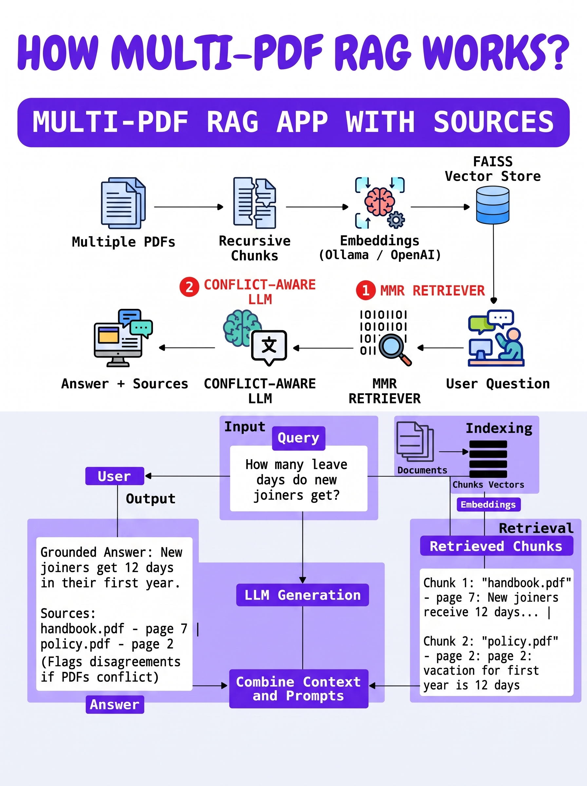

# 📚 Multi-PDF RAG App with Sources

A single-file Retrieval-Augmented Generation (RAG) web application built with **Streamlit**, **LangChain**, and **FAISS**. Upload multiple PDFs at once, index them into one unified vector database, and ask questions with exact **file name and page number** citations.

**🌐 Live App:** [Launch Multi-PDF RAG App](https://multi-pdf-rag-app-nslb9ngrg2pkk8daxcmnwu.streamlit.app/) *(Bring Your Own OpenAI API Key)*

---

## ✨ Key Features

- **Multi-PDF Batch Indexing:** Upload multiple PDF documents at once and embed them into a single in-memory **FAISS** vector store stored in `st.session_state`, with live chunk-count reporting.
- **Verifiable Source Citations:** Every answer displays deduplicated `filename - page X` badges (1-indexed) alongside an expandable **Inspect retrieved excerpts** panel.
- **MMR Retrieval:** Uses **Maximal Marginal Relevance (`search_type="mmr"`)** instead of basic similarity search to retrieve diverse, non-redundant chunks across documents.
- **Conflict-Aware Prompting:** Explicitly surfaces disagreements when two uploaded PDFs state conflicting facts—quoting what each file and page says rather than silently picking one.
- **Dual-Provider, Cost-Conscious Design:**
  - **OpenAI (Live Web App — BYOK):** Visitors enter their own OpenAI API key in the masked sidebar input (kept only in their browser session). Uses low-cost `gpt-4o-mini` + `text-embedding-3-small`.
  - **Ollama (100% Free Local Mode):** Automatically detects a local Ollama instance, checks for required models (`llama3.2`, `qwen2.5:3b`, `mistral`, and `nomic-embed-text`), and provides a **one-click in-app model downloader** with a live progress bar.

---

## 🏗️ Architecture

| Stage | Implementation |
| :--- | :--- |
| **Document Loader** | `PyPDFLoader` (preserves real uploaded filename & 1-indexed page metadata) |
| **Chunking** | `RecursiveCharacterTextSplitter` (default `chunk_size=1000`, `chunk_overlap=150`, tunable in UI) |
| **Embeddings** | `text-embedding-3-small` (OpenAI) or `nomic-embed-text` (Ollama) |
| **Vector Store** | `FAISS` (`faiss-cpu`) stored in `st.session_state` |
| **Retrieval** | Dense Retrieval with **MMR** (`k=4`, tunable in UI) |
| **Generation** | Grounded, conflict-aware `ChatPromptTemplate` with `ChatOpenAI` or `ChatOllama` |

---

## 🚀 Run Locally

### 1. Clone the Repository
```bash
git clone [https://github.com/udhayakumarpanneerselvamuk-eng/multi-pdf-rag-app.git](https://github.com/udhayakumarpanneerselvamuk-eng/multi-pdf-rag-app.git)
cd multi-pdf-rag-app

## 📸 Demo

### App Screenshot (Answer with Sources)


### How It Works
